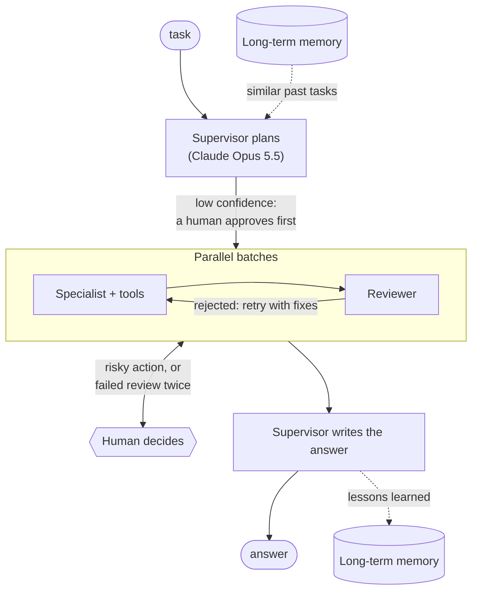

# Tether

**Multi-agent orchestration with a human on the line.** Agents plan, use tools, check
each other's work and learn from past tasks, while staying tethered to a person who
approves what matters.


[](https://github.com/skodali31/tether/actions/workflows/ci.yml)
[](LICENSE)

You give Tether a task in plain language. A **supervisor agent** turns it into a plan
of subtasks, **specialist agents** carry out the subtasks with real tools, and a
**reviewer agent** checks every result before it is used. The system **remembers** what
worked for the next task, **stops for a human** when confidence is low or an action is
risky, and **records every step**, so any run can be inspected, costed and replayed with
changes.


## What it does

- **Plans.** A supervisor (Claude Opus 5.5) splits your request into smaller steps and
  runs the independent ones at the same time.
- **Uses real tools.** Four specialist agents (research, analysis, writing, code) can
  search the web, read pages, write files, run Python in a sandbox and query a database.
- **Checks its own work.** A reviewer agent checks every result. Weak results are retried
  with feedback, and anything that fails twice goes to a person.
- **Learns.** Lessons from each task are saved and used to plan the next similar one.
- **Asks before risky moves.** It pauses for a person when it's unsure or about to do
  something sensitive, like overwriting a file.
- **Shows its work.** Every model call and tool call is recorded with its cost, and any
  run can be replayed with changes.
- **Doesn't lose progress.** If a worker crashes, the run picks up where it left off.

## How it works



Under the hood: a LangGraph workflow, a FastAPI server, Celery workers, and Postgres,
Redis and ChromaDB for storage. [docs/ARCHITECTURE.md](docs/ARCHITECTURE.md) has the full
technical write-up.

## Dashboards

**Review queue:** start tasks, watch them run, and approve or reject anything waiting on you.


**Replay:** rerun any finished task from any step with changes, and compare the two.


**Memory:** see what the system has learned about each user.


The trace explorer at the top of this page shows where the time and money went in a run.

## Try it

You need Docker and an [Anthropic API key](https://console.anthropic.com/).

```bash
git clone https://github.com/skodali31/tether.git
cd tether
cp .env.example .env    # then set ANTHROPIC_API_KEY
make stack              # starts everything in Docker
make demo               # runs the showcase task
```

Then open http://localhost:8000. The demo compares cloud storage prices across AWS,
Google Cloud and Azure. It takes about 5 minutes and costs about $1.

Settings are listed in [.env.example](.env.example), and the API docs are at
http://localhost:8000/docs once it's running.

## Results

The showcase task finished in about 5 minutes for **$0.84–$1.10**, with all steps
done and two human check-ins each run. When the price pages couldn't be read directly,
the final answers said so and marked which numbers needed checking, instead of making
them up.

**Tests:** 139 unit tests, plus end-to-end tests on the real services, all run in CI.

```bash
make test    # fast unit tests, no API cost
make e2e     # end-to-end tests (needs `make up`)
```

## Challenges

- **A runaway agent.** The first demo spent **$2.71** without finishing. One agent kept
  downloading a huge price file, and every step got more expensive. The traces showed
  exactly where the money went. I added a spending limit per agent and capped tool output
  size, and the same task now finishes for under $1.10.
- **A reviewer that was too strict.** Early on it rejected good work over style. Now it
  separates real problems from suggestions, and only real problems cause a retry.
- **Memory that missed things.** A saved preference wasn't being found for unrelated
  tasks. I measured the similarity scores and gave preferences a looser match, since
  they apply everywhere.
- **Crashes without double work.** If a worker dies, the job is redelivered. Every run
  continues from its last saved step, so running it twice is harmless.

## Limitations

- No login on the API or dashboards.
- No cancel button for a running task.
- Claude only for now; support for other providers is planned.

## Tech stack

Python · LangGraph · Claude (Opus 5.5 + Sonnet 5.5) · FastAPI · Celery · PostgreSQL ·
Redis · ChromaDB · OpenTelemetry · Docker

## Author

**Sai Siddharth Kodali**

Licensed under the [MIT License](LICENSE).
